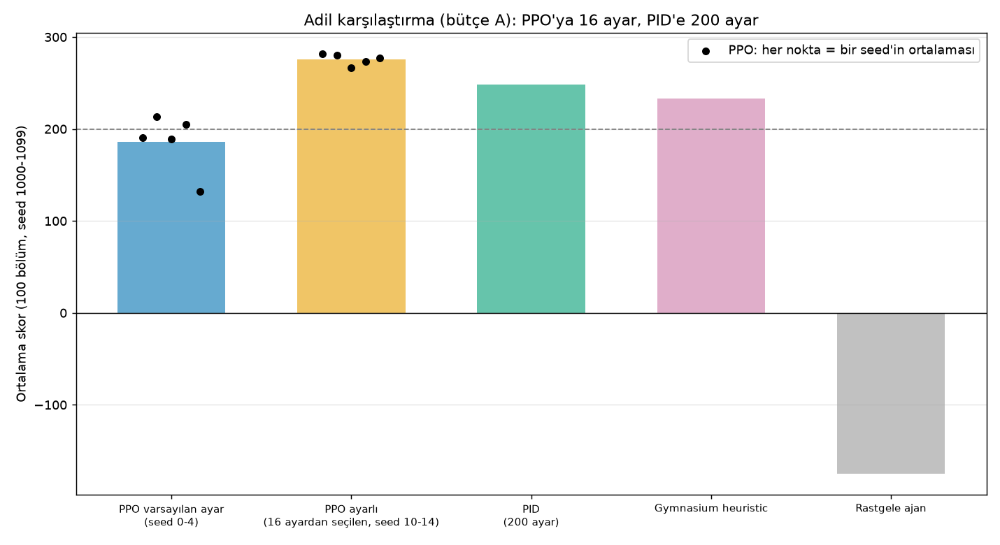
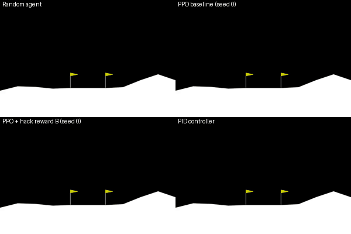
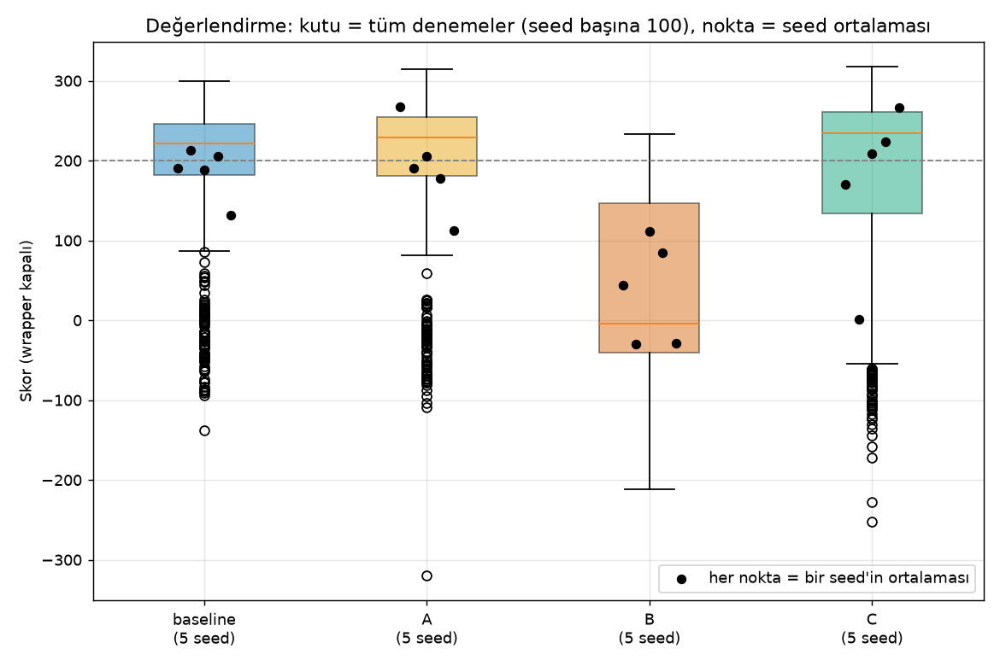
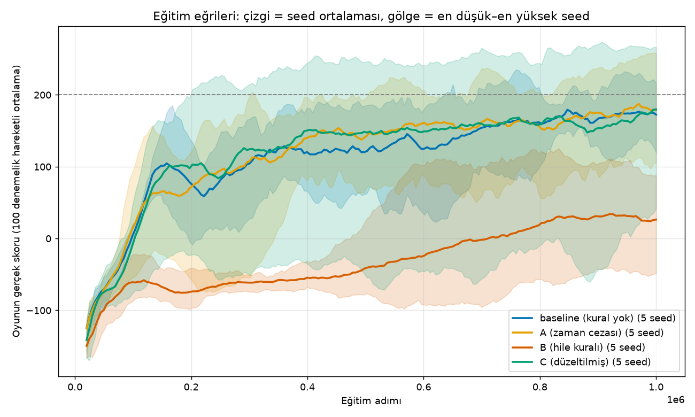
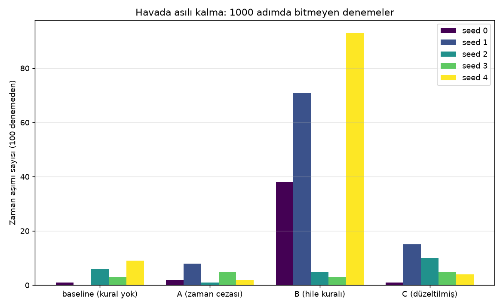
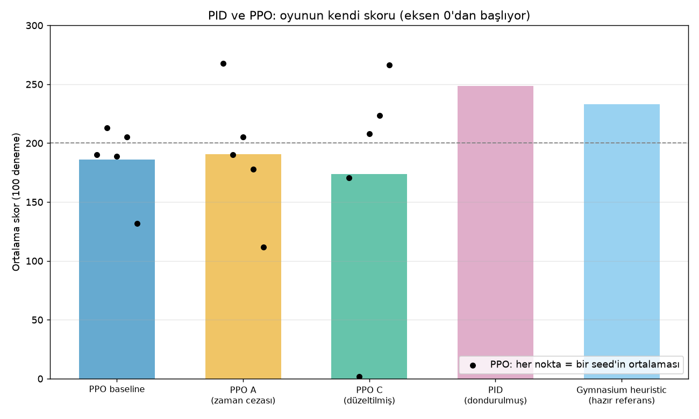

# Reward shaping on LunarLander: PPO vs. a hand-written PID controller

## Update (Stage 6): fairer comparison

In Stages 1-5 PPO ran with the library's default settings, while the PID controller had 200 tuning candidates. That was not a fair budget comparison. In Stage 6 PPO also got a tuning budget:

- 16 PPO settings were drawn at random from fixed ranges (generator seed 6001; all 16 are in `results/ayar_ppo/ayarlar.json`). Each was trained for one million steps (training seed 0), with the game's own reward (no reward wrapper).
- The best setting (setting 14) was chosen using **only tuning seeds 0-99** (mean 282.4 there). Start seeds 1000-1099 were not used for the choice.
- Setting 14 was then retrained with 5 new training seeds (10-14) and evaluated once on start seeds 1000-1099 (100 episodes per model, deterministic actions).
- **Result:** in this setup, with this budget, on these 100 start seeds, the mean score of tuned PPO was higher than the PID's: 275.7 ± 6.1 (std across the 5 seed means; seed means 266.2 – 281.6; 99.4% of episodes above 200; 2 timeouts in 500 episodes). The PID scored 248.7 (97% above 200, 1 timeout in 100), default-settings PPO 185.9 ± 31.8.
- The comparison is still **not equal** (16 PPO settings vs. 200 PID settings, different kinds of budget; see Limitations). Why this setting works well was not measured.



I trained PPO agents on LunarLander-v3 with several reward definitions (including a deliberately hackable one), ran each for 5 seeds, and compared the results with a hand-written PID controller and Gymnasium's built-in `heuristic`.



*Same start (seed 1000). Top left: random agent. Top right: PPO baseline (seed 0). Bottom left: PPO with hackable reward B (seed 0): it hovers near the ground. Bottom right: PID.*

## Headline results (honest version)

- **Reward hacking reproduced.** With reward B (+1 per frame while upright and slow), the agent learned to wait near the ground instead of landing. In the 3 of 5 seeds where this was clear, 38, 71, 93 of 100 test episodes timed out (seeds 0, 1, 4). Baseline had 19 timeouts in 500 test episodes; B had 210 in 500.
- **One seed was misleading.** Reward A scored 267.6 on seed 0 (baseline seed 0: 190.4), but over 5 seeds the means were 190.5 (A) and 185.9 (baseline), with seed-to-seed std 55.9 and 31.8. In these 5 seeds the difference is unclear.
- **The fixed reward C removed most hovering but was not consistently better.** Timeouts dropped from 210 to 35 (out of 500). Its mean score (174.0) was below baseline, and one seed (seed 1) collapsed to a mean of 1.7.
- **A tuned PID controller scored higher than default-settings PPO in this setup** (248.7 vs 185.9-190.5 for the PPO runs without hack reward; the PPO C mean was 174.0). This is not a fair-budget comparison: the PID got 200 tuning candidates, PPO stayed at default settings.
  *Superseded by the Stage 6 update above: PPO later got 16 tuning settings.*

All numbers: 100 test episodes per trained model, start seeds 1000-1099, the game's own score (no reward wrapper), deterministic actions. Observations about 5 seeds show a direction; they do not prove anything.

## Results table

| Method | Mean score (mean ± std across 5 seeds) | Lowest – highest seed mean | Success rate (score > 200) | Mean episode length (steps) | Timeouts |
|---|---|---|---|---|---|
| PPO baseline (game's own reward) | 185.9 ± 31.8 | 132.0 – 213.1 | 67.8% | 413 | 19 / 500 |
| PPO + reward A (time penalty) | 190.5 ± 55.9 | 112.0 – 267.6 | 68.4% | 370 | 18 / 500 |
| PPO + reward B (deliberately hackable) | 36.4 ± 64.7 | -29.7 – 111.7 | 2.2% | 811 | 210 / 500 |
| PPO + reward C (potential-based + time penalty) | 174.0 ± 102.2 | 1.7 – 266.1 | 64.4% | 376 | 35 / 500 |
| PPO tuned (best of 16 settings, 5 new seeds 10-14; Stage 6) | 275.7 ± 6.1 | 266.2 – 281.6 | 99.4% | 233 | 2 / 500 |
| PID controller (hand-written, tuned on seeds 0-99) | 248.7 (single controller) | – | 97.0% | 369 | 1 / 100 |
| Gymnasium `heuristic` (reference, not written by us) | 233.1 (single controller) | – | 90.0% | 235 | 0 / 100 |

The "PPO baseline" row uses default settings and training seeds 0-4; the "PPO tuned" row uses the Stage 6 setting and training seeds 10-14 (both: the game's own reward). Selection details: `results/ayar_ppo/secim_tablosu.md`; comparison table: `results/ayar_ppo/adil_karsilastirma.md`.

Seed-level numbers: `results/ozet_seed_tablosu.md`. PID and heuristic extra check on 500 more start seeds (1100-1599): PID mean 241.4, heuristic mean 235.4. A random agent scored -174.8 on average (std 108.9, 0 of 100 above 200).






## Quick start

Tested on Windows 11 with Python 3.13 (PowerShell). The Linux/macOS commands below are the same steps but were **not tested**.

```powershell
python -m venv .venv
.\.venv\Scripts\Activate.ps1
pip install -r requirements-min.txt
python scripts/ortam_testi.py
python scripts/degerlendir_v2.py --model models/ppo_baseline_seed0.zip --etiket my_check
python scripts/degerlendir_pid.py
```

```bash
# Linux / macOS (not tested)
python3 -m venv .venv
source .venv/bin/activate
pip install -r requirements-min.txt
python scripts/ortam_testi.py
python scripts/degerlendir_v2.py --model models/ppo_baseline_seed0.zip --etiket my_check
python scripts/degerlendir_pid.py
```

`degerlendir_v2.py` writes `results/my_check_eval.csv`. `degerlendir_pid.py` re-evaluates the frozen PID and the heuristic and **overwrites** `results/pid_eval*.csv` and `results/heuristic_eval*.csv` with identical numbers (back them up first if you want to keep the originals). Train one model: `python scripts/egit_ppo_v2.py --varyant baseline --seed 0 --adim 1000000`. Measured training times (one million steps per run, 8 runs in parallel on this machine): first wave (baseline and A, seeds 1-4) 1595-1603 s per run, second wave (B and C, seeds 1-4) 1461-1472 s per run. Stage 6: the 16 tuning runs (two waves of 8, different settings) took 82 min 10 s in total (14:23:48 to 15:45:58 in the log), single runs 1228-2663 s depending on the setting; the 5 retrainings of the chosen setting (5 in parallel) took about 1488 s each. Sources: `results/*/sure.txt` and `results/ayar_ppo/dalga_surucu.log`.

**Reproducibility.** Saved models and the frozen PID were re-evaluated in a fresh virtual environment built from `requirements-min.txt` and matched the stored CSVs episode by episode (PPO baseline, A, C seed 0, PID, heuristic). Two separate 50000-step baseline trainings (seed 0, one thread) produced bit-for-bit identical weights and identical scores on 20 start seeds. This was checked on one machine only (Windows 11, CPU). That check covers Stages 1-5; the Stage 6 results (tuning, retraining, evaluation) were **not re-verified in a fresh environment**.

## Project structure

```
scripts/
  odul_wrapper.py        reward variants A, B, C (wrapper around the game's reward)
  egit_ppo_v2.py         train PPO (variants baseline, A, B, C; any seed)
  degerlendir_v2.py      evaluate a model: 100 episodes, seeds 1000-1099, no wrapper
  pid_kontrolcu.py       hand-written PID controller
  ayar_pid.py            PID tuning (random search, only seeds 0-99)
  degerlendir_pid.py     evaluate frozen PID and Gymnasium heuristic
  ozet.py, karsilastir.py   tables and plots
  rapor_sayilari.py, rapor_olustur.py, rapor_dogrula.py   numbers -> docs/sayilar.json -> README/REPORT, with a number check
  yon_testi.py           measures what each action does (used before writing the PID)
  egit_ppo_ayar.py       Stage 6: train PPO with setting number N from results/ayar_ppo/ayarlar.json (no reward wrapper)
  ayar_sec_ppo.py        Stage 6: score models on tuning seeds 0-99 only (asserts the seeds) and pick the best setting
  ayar_ppo_uret.py, dalga_surucu_ayar.py, adil_karsilastir.py   Stage 6: draw the 16 settings (seed 6001), run the 16 trainings in two waves, final table and plot
  (older scripts: egit_ppo.py, degerlendir.py, kayit*.py, ...: earlier stages)
models/    trained PPO models (.zip); models/ayar_ppo/ = Stage 6 (16 settings + 5 retrained seeds)
results/   monitor logs, evaluation CSVs, tables, plots
results/ayar_ppo/   Stage 6: ayarlar.json (the 16 settings), secim_tablosu.md (selection on seeds 0-99), kazanan_seed10..14 (retrained runs and *_eval.csv), adil_karsilastirma.md/.png (final comparison), durustluk_notu.md (honesty note)
videos/    recorded episodes
docs/      demo.gif, plots, sayilar.json (every number in README/REPORT)
```

## How the reward variants work

Observation (8 numbers): x, y, horizontal speed, vertical speed, tilt, rotation speed, left leg contact, right leg contact. "Good state" = tilt < 0.2, horizontal speed < 0.5, vertical speed < 0.5 in absolute value (**assumption**: reasonable values, not tuned).

- **A:** game reward − 0.05 every frame (time penalty).
- **B (hackable):** game reward + 1 every frame while in the good state. Waiting in the good state pays forever.
- **C (fixed):** game reward + (good-state indicator now − before) − 0.05 per frame. Only *getting into* the good state pays, and waiting costs.

The training logs record the game's real score, not the shaped one.

## Limitations

- One environment (LunarLander-v3), one reward definition set, one PPO setting (library defaults), 5 seeds.
  *Stages 1-5. Stage 6 later added a 16-setting search for PPO with the game's own reward only.*
- The "good state" thresholds (0.2 / 0.5 / 0.5 for tilt, horizontal speed, vertical speed) are an assumption and were not tuned. The B and C results may depend on them.
- All methods are evaluated on the same 100 start seeds (1000-1099). This makes the comparison fair, but the numbers may be specific to these 100 starts.
- PPO was not given the tuning budget that the PID received.
  *Superseded by the Stage 6 update above: PPO later got 16 tuning settings.*
- Stage 6 budgets are still not equal: PPO got 16 settings, the PID 200 (different kinds of budget: one PPO setting is a one-million-step training, one PID setting is a short simulation).
- The PID's settings were scored on 20 episodes (the best 5 on 100); PPO's settings were scored on 100 episodes.
- The PPO setting search used one training seed (seed 0), so the chosen setting may have been lucky. The 5 new seeds (10-14) are a check: mean 275.7 there vs. 282.4 in the selection. This is only one check.
- The PID's landing logic was written by hand; PPO learned its own.
- Stage 6 numbers may be specific to the 100 start seeds (1000-1099). An extra 500-episode check exists for the PID (mean 241.4) but was not run for tuned PPO.
- Why the tuned PPO setting works well was not measured.
- One computer (Windows, CPU only). Training times may have been affected by other processes.
- The Gymnasium `heuristic` reference was not written by us.

## Credits

- [Gymnasium](https://gymnasium.farama.org/) (LunarLander-v3) and [Stable-Baselines3](https://stable-baselines3.readthedocs.io/) (PPO).
- PPO: Schulman et al., "Proximal Policy Optimization Algorithms", 2017.
- Idea inspired by the post "Training an AI to land a rocket with reward shaping" by Hari (@harixganesh).
- The `heuristic` function in `gymnasium.envs.box2d.lunar_lander` was **not written by us**. It is a hand-tuned controller from the Gymnasium authors, used here only as a reference. The PID code in this repo was written from scratch.

## License

MIT. See [LICENSE](LICENSE).
